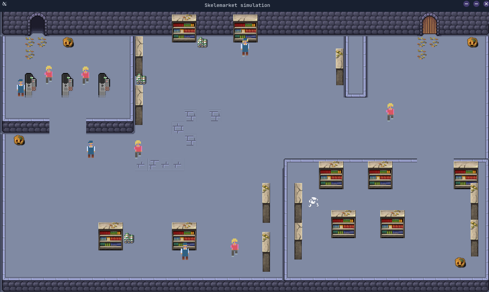

# Skelemarket

**Skelemarket** is a simple supermarket simulation written in Java for school using JavaFX. It includes keeping restocking, path finding & more...

## Preview

## Features

- **Path Finding** – Different customers follow different paths based on an algorithm
- **Restocking** – Warehouse employees that restock the shelves
- **Customer queueing** – Customers queue at the checkouts
- **Dynamic map loading** – Load any map from a file
- **Custom map builder** – Custom web-based map builder

## Getting Started

### Prerequisites

Ensure you have the following installed on your system:
- Runtime: [Java JDK 21](./doc/Java-21-help.md)

### Building, Testing & Running

Build and run instructions for this project can be found in the [BUILDING.md](BUILDING.md) file. Supported platforms are:
- **Windows**: IntelliJ, Eclipse, Gradle
- **Linux**: IntelliJ, Gradle
- **MacOS**: IntelliJ, Gradle

## License

All rights reserved.

This project is provided for viewing purposes only.  
You may not copy, modify, distribute, or use any part of this code without explicit written permission from the authors.

## Contributing

Contributions are welcome! Please fork the repository and create a pull request with your changes.
